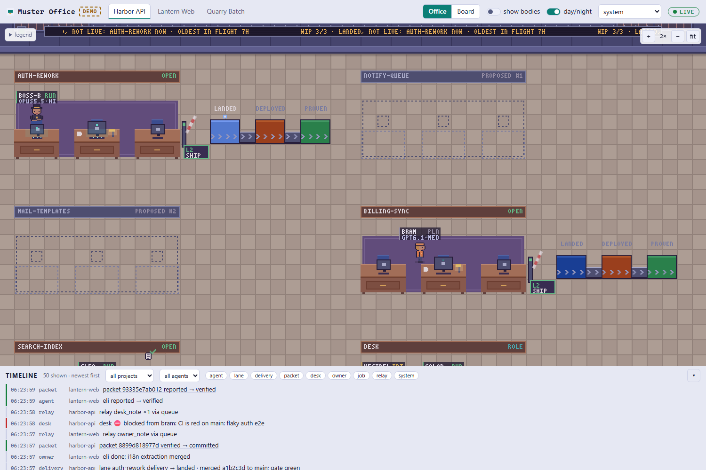
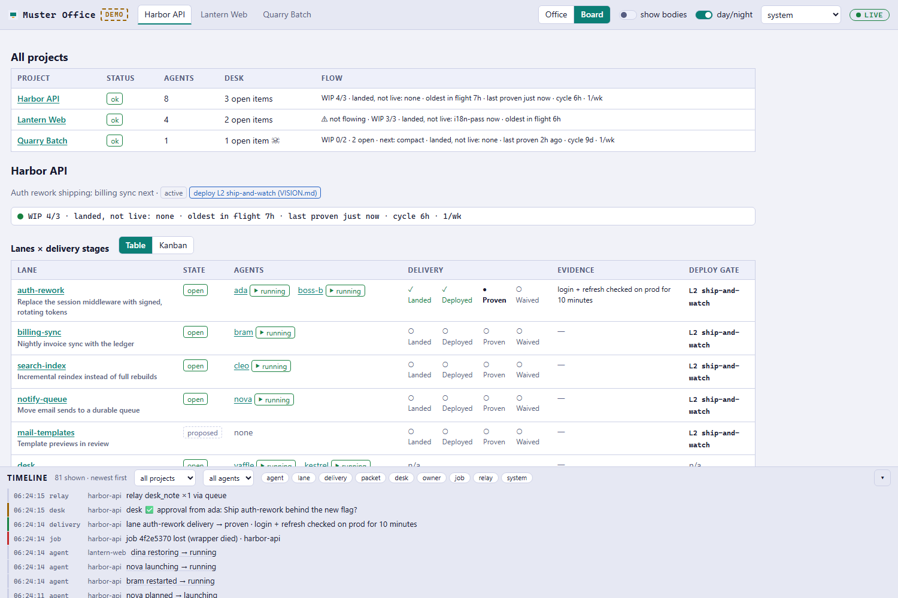

# Muster Office

A read-only, localhost, live dashboard for [pi-muster](https://github.com/joelhooks/pi-muster) that
shows your agents as pixel-art characters working in an office.



Each Muster **project** is a floor. Each **lane** is a desk pod with one main chair. Each **agent** is a
character whose look depends on its role. **Packets** are sheets of paper that get carried to the desk,
stamped, and sent down a conveyor to be deployed and proven. The **operator desk** has inbox trays that
catch fire when decisions pile up. `muster-heavy` jobs hum away in a machine room.

If you would rather not watch cartoons, the **Board** view is the same data as plain accessible tables.

> **Read-only by construction.** The server binds to `127.0.0.1`, has no write endpoints, runs no
> commands, and never opens a file for writing. See [Security model](#security-model).

## Quick start

```bash
npm install
npm run demo        # synthetic data, no Muster needed
```

Open the URL it prints (default <http://127.0.0.1:4747>). The demo loops a deterministic script that
walks every agent through every lifecycle state, stalls a flow, fails an agent, blocks the desk,
loses a job and queues work at the door.

With real Muster data:

```bash
npm run build && node bin/muster-office.mjs        # or: npx muster-office
```

| Option | Meaning |
| --- | --- |
| `--demo` | Run the built-in simulator instead of reading files |
| `--port <n>` | Port (default 4747; if you do not pass one and it is busy, the next free port is used; `0` = any) |
| `--home <dir>` | Home directory that contains `.local/state/muster` (default `$HOME`; env `MUSTER_OFFICE_HOME`) |
| `--poll` | Poll the filesystem instead of using native watchers (network drives, some containers) |
| `--tick-ms <n>` | Demo only: milliseconds per simulator step (default 2500) |

The CLI prints the URL; it deliberately does not launch a browser (that would be the server running a
command).

## What you are looking at

### The metaphor, from real Muster concepts

| Muster | In the office |
| --- | --- |
| Project | A floor, chosen with the tabs. The sidebar headline hangs on the wall as a sign |
| Lane | A bay with a desk pod. Work lanes get a delivery strip and a deploy gate; role lanes (desk, hawk, boss, judge) get a teal rug |
| Lane `proposed` | A dotted outline of an empty desk (no chair, no rug) |
| Lane `draining` | The pod is dimmed with a yellow dashed edge |
| Lane `closed` | A greyed pod; its delivery pads still show where it ended |
| One writer per lane | The `worker` takes the main (middle) chair; boss, judge and hawk take the side chairs; anyone else stands in the aisle |
| Agent roles | `worker` hoodie · `boss` top hat and suit · `hawk` green visor with a feather · `judge` white wig and robe · `desk` operator headset and vest. Model and thinking level are in the name plate |
| Packet | A sheet of paper. Hover a pad, tray or agent for its short hash |
| The desk | A front desk with four trays (packets, blocked, approval, decision). Open items rank blocked › approval › decision and pile up as sheets; **flames** grow with weight (3/2/1) and log-age, like the Switchboard flame graph. No desk agent running while items are open puts a **skull** on the counter |
| Delivery pipeline | Per lane: landed → deployed → proven (or waived) as pads on a conveyor. The packet token rides the belt as the stage advances; hover for the evidence text |
| Flow line | A scrolling LED ticker on the wall with the exact Muster line, e.g. `WIP 2/3 · landed, not live: lexicon-pin 40m · oldest in flight 2h`. When flow stalls (`⚠ not flowing`) the warning light blinks |
| WIP over the limit | The backlog queues up beside the door (one waiting character per proposed lane, in rank order) |
| Deploy posture | A gate between the pod and its strip. Arm down = locked (0), up = jfdi (3). The plate shows the effective level; badges show the deploy rule and a WIP override |
| `muster-heavy` jobs | Racks in a glass-walled machine room with live CPU % and RSS gauges. Hover for the (redacted) command. A lost job is a dark, cracked rack |

### Lifecycle → animation

Driven by the real state enums (`agentMachine` in pi-muster's `src/machines.ts`). A state change in the
data starts an animation; it never teleports.

| State | What you see |
| --- | --- |
| `planned` | Empty chair, blueprint on the desk |
| `launching` | Walks in from the door to the chair, a speech bubble while it boots |
| `running` | Typing, a screen glow, an occasional speech bubble |
| `silent` | Slumps, `Z Z Z` |
| `nudged` | Sits up with a `!` bubble |
| `restarted` | Spins in the chair with a reboot spinner, then back to typing |
| `reported` | Stands, picks up a sheet, walks to the front desk and drops it in the packet tray, walks back |
| `verified` | The desk operator stamps the packet (sparks, check mark) |
| `landed` | The packet leaves the tray and flies to the lane's first pad |
| `closed` | Stands and walks out of the door; the chair empties |
| `failed` | Red smoke and sparks, an error icon, stays at the desk |
| `interrupted` / `restoring` | A translucent ghost; restoring materialises (scan line) back to solid |

Also: a new desk item flares on its pile and a resolved one settles with a check mark; a
day/night tint follows your local time (toggle it); bursts of events are queued and sped up, and a
backlog beyond ~30 s of movement fast-forwards instead of replaying.

### Controls

- **Mouse:** drag to pan, wheel to zoom (integer zoom only, so the pixels stay crisp), click a character, desk, pod, gate, pad, rack or the door to open its panel, hover for details.
- **Keyboard** (focus the canvas): arrows pan · `+`/`-` zoom · `0` fit · `N`/`P` step through agents then the desk · `Enter` opens the hovered item · `Esc` closes the panel.
- **Top bar:** project tabs, Office/Board, *show bodies*, day/night, theme (system, dark, light, **mono**), connection status (`live`, `reconnecting`, `degraded` with a list of what is wrong), and a `DEMO` badge in demo mode.
- **Panel:** agent role/model/thinking, state history, last report and checks, related desk items and owner notes; lane delivery stage with evidence history and deploy level/rule/override; packets; job details.
- **Timeline** (bottom, newest first): state changes plus relay events, filterable by project, agent and kind.
- **Reduced motion** (`prefers-reduced-motion`): static poses, no walking or particles, drawn only when data changes; every state also has a text badge on its name plate. **Idle:** the loop freezes after ~60 s with no data and no input and wakes on either; it also pauses while the tab is hidden.

### Board view (accessible fallback)

Everything on the canvas is reachable here as semantic tables: projects overview, lanes × delivery
stages (table or kanban), agents, the ranked desk, packets, jobs, relay counters, plus the same
side panel. State changes are announced through a polite live region; the canvas itself carries a
text summary for screen readers.



## Data sources (all read-only)

Resolved from `--home` / `MUSTER_OFFICE_HOME` / `$HOME`, exactly as Muster resolves its own home.
Full schemas and state enums are in [docs/data-contract.md](docs/data-contract.md); the source of truth is the pi-muster repo.

| File | Used for |
| --- | --- |
| `~/.local/state/muster/projects.jsonl` | The project registry (newest line per slug wins). Project directories are *only* discovered from here |
| `<project>/.brain/data/muster/project.json` | Project, lanes, agents, packets (decoded tolerantly; the file is replaced by atomic rename) |
| `<project>/VISION.md` | Only its `## Deploy posture` section, to compute the effective deploy level (VISION wins over policy) |
| `<project>/.brain/data/muster/reports/…` | Packet reports, only when you ask for a body |
| `~/.local/state/herdr-desk/<slug>.jsonl` | Desk queue (also shows queues for slugs that are not registered) |
| `~/.local/state/muster/owner-queue/<session>.jsonl` | Owner notes (`dev.muster.note.post`); the title is the first line of `text` |
| `~/.local/state/muster/jobs/<id>.json`, `samples.json` | `muster-heavy` jobs and live CPU/RSS |
| `~/.local/state/muster/relay-events.jsonl` | Relay counters for the timeline (metadata only) |

Files that can be torn, missing, corrupt or from a newer Muster never crash the app: a bad row is
skipped, a half-written catalog keeps showing the last good one, and the project gets a **degraded**
badge with the reasons. JSONL files are tailed by byte offset and reset when the file is truncated or
replaced. Changes show up in well under a second (a native watcher, with a 5 s rescan as a backstop).

## Security model

- Listens on **`127.0.0.1` only**. `Host` must be `127.0.0.1`, `localhost` or `[::1]` on the bound port and any `Origin` must be the same, which defeats DNS rebinding. Cross-site requests to the API are refused.
- **GET and HEAD only**, no CORS headers, no write endpoints. There are no command-execution paths; `child_process` is banned by lint and by a source-scan test.
- **Never writes.** One module (`SafeReader`) performs every file access, with the `r` flag only. A test records every fs call made from server code during a full session and fails on any write-capable API or any non-read open flag; another scans the sources. The server does not even create a cache directory.
- **Reads only inside roots from the registry** (plus Muster's fixed state directories). Paths found in catalogs (such as a packet's `report`) are untrusted: they are resolved with `realpath` and rejected unless they land inside a root, so `..` traversal and symlinks pointing outside are denied. Missing-versus-denied is not an oracle for files outside the roots.
- Security headers on every response: a strict CSP (`default-src 'none'`, scripts from self only), `nosniff`, no referrer, frame denial.
- Text from files is stripped of terminal escapes, control characters and bidi overrides before it leaves the server, and React never renders HTML from data.

> Binding to loopback keeps other machines out, but on a **shared** machine every local user can reach
> `127.0.0.1`. Run it on a machine you trust, or put it behind your own access control.

### Privacy defaults

- Desk, owner and report **bodies are not sent to the browser** until you turn on *show bodies*; then only the item you are looking at is fetched. The toggle persists in `localStorage` (guarded, so private mode is fine).
- Environment variables, launch profiles' `env`, restore commands, session files, pane ids and working directories are never forwarded. Views are built from explicit allow-lists, and a test plants secrets in a catalog and checks none reaches the wire.
- Session ids are shortened; owner notes are keyed by a content id, not the session-bearing URI.
- `muster-heavy` commands are shown on hover **after redaction** (tokens in flags, `*_KEY=`/`*_TOKEN=`, URL credentials, bearer headers, well-known token shapes) and capped at 300 characters.

## Demo mode

`npm run demo` (or `--demo`) runs a deterministic simulator. It does not write files: it emits the same
raw documents Muster would write (`project.json` text, JSONL lines, job JSON) into the same parsers,
model, diff engine and SSE stream as the real thing, so everything you see is exercised by the real code.
It loops every 84 steps (about 3.5 minutes at the default speed) through:

- all 13 agent states, including a restart, a failed launch that is restored, a hawk that is interrupted and restoring
- a stalled, "not flowing" project, and one that flows
- blocked, approval and decision items with flames of different heat, resolved over time
- a `landed → deployed → proven` delivery and a waived lane, at deploy levels 0–3 (with a rule and an override)
- WIP at the limit with two lanes queued at the door, then a slot freeing
- a lost job, finished jobs (exit 0 and 1) and running ones; a project with a **dead desk**

The script is a pure function of the step number (see `packages/shared/src/demo/world.ts`), which is
what makes it testable.

## Development

```bash
npm run check        # typecheck + lint + unit tests
npm run test:e2e     # build, then the Playwright suite (first: npx playwright install chromium)
npm run dev          # esbuild watch + node --watch server + Vite with a proxy (add --demo)
```

```
packages/shared   types, tolerant parsers, derivations (flow line, WIP, desk heat), diff/apply protocol, demo script
packages/server   SafeReader, JSONL tailer, model, watchers, SSE, host guard, CLI, demo source
packages/web      React UI, Zustand store, SSE client, the office (layout, A*, sprites, world, renderer, engine)
e2e/              Playwright smoke, live-file and perf tests
scripts/          build-server, dev, screenshot, fixture-home
docs/             data-contract, decisions, sprites
```

**Try the real (non-demo) path without Muster:**

```bash
node scripts/fixture-home.mjs /tmp/muster-home --loop     # writes a Muster-shaped home and keeps changing it
node bin/muster-office.mjs --home /tmp/muster-home
```

**Screenshots and GIFs.** `scripts/screenshot.mjs` drives the page with Playwright (read-only):

```bash
npm run demo &
node scripts/screenshot.mjs --out docs/screenshots/office.png --zoom 2 --focus 376,230 --wait 12000
node scripts/screenshot.mjs --view board --out docs/screenshots/board.png
node scripts/screenshot.mjs --theme mono --out docs/screenshots/office-mono.png

# a GIF: 60 frames, 100 ms apart, then stitch them (ffmpeg or gifski)
node scripts/screenshot.mjs --out frames/f.png --zoom 3 --focus 170,160 --frames 60 --every 100
ffmpeg -framerate 10 -i frames/f-%03d.png -vf "scale=iw:-1:flags=neighbor" office.gif
```

`/#sprites` shows every role in every pose, which is handy when drawing sprites.

### Adding custom sprites

All drawing goes through a `SpriteSet` interface, so the procedural pixel art can be replaced by a
PNG sprite sheet without touching the engine. See [docs/sprites.md](docs/sprites.md).

## Known limitations

- **Verified against schema-faithful fixtures and the simulator, not against a live Muster install**; none was available while building it. The contract was derived from pi-muster's source at commit `e415c70`. Newer schema versions are read best-effort and flagged.
- "Dead desk" is **approximated from the catalog** (open items and no desk-role agent in a running state); Muster itself uses its live intercom session list, which is not on disk.
- Jobs are host-wide; mapping them to a project is a heuristic (cwd inside the project dir, else `repo` equals the slug or directory name). The machine room is drawn on every floor and highlights the matching jobs. Running jobs with telemetry older than a minute are flagged *stale*.
- Owner notes whose project cannot be determined (no `project` field and an author that is in no catalog) are not shown.
- One floor at a time (tabs), not a stacked building. Up to 14 racks, 12 queued characters and three seats per lane (further agents stand in the aisle).
- Report bodies are shown as text, not rendered MDsveX.
- The bundled sprites are procedural and small by design; there is no art pack.
- The server trusts the local machine (see the shared-machine note above) and has no authentication.

## License

MIT. See [LICENSE](LICENSE).
